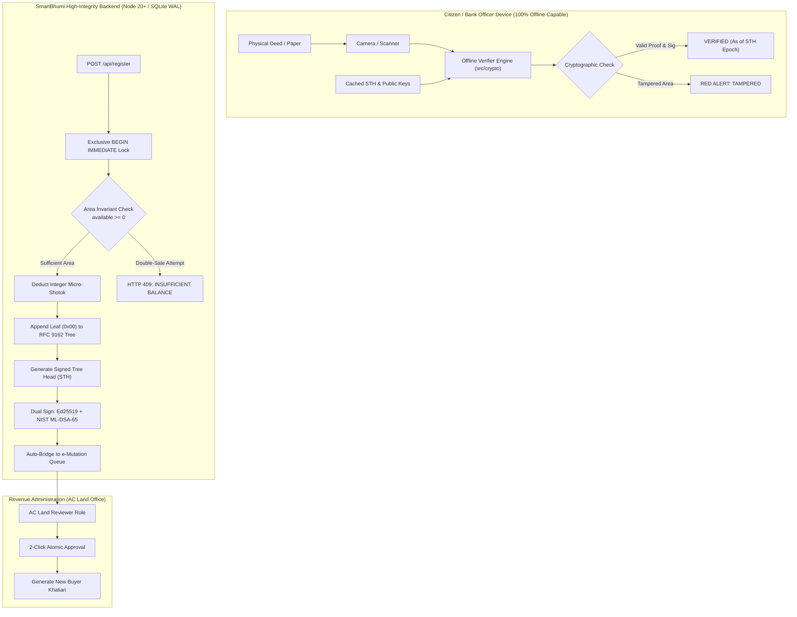

# SmartBhumi (স্মার্টভূমি) — Final Round Submission
## DIU LandTech Innovation Hackathon 2026
### Track: Digital Land Records, Verification & Digitization (Problems P2, P3, P4)

[](file:///tests/smartbhumi.test.ts)
[](file:///tests/verification.test.mjs)
[-065f46)](file:///scripts/benchPqc.ts)
[](file:///server/logManager.ts)
[-blueviolet)](file:///src/crypto/offlineVerifier.ts)
[](LICENSE)

> [!IMPORTANT]
> **SYNTHETIC DEMO DATA DECLARATION (Hard Rule 1)**: All records in SmartBhumi are 100% synthetic mock demonstration data. All National IDs strictly begin with prefix `999000...`. No real citizens, phone numbers, or government records are depicted or processed. This prototype never calls or scrapes any `.gov.bd` production service.

---

## 1. System Overview & The Championship Leap

In Round 1, our prototype placed **26th**. The initial version operated exclusively inside browser `localStorage`, relied on fragile raw byte hashes (which failed whenever a deed was rescanned or re-saved as a PDF), lacked transactional double-sale prevention, and provided no bridge between the Sub-Registrar and e-Mutation.

For the **Final Round**, SmartBhumi underwent a complete architectural rebuild to solve the core triad of land administration challenges:
- **Problem P2 (Deed & Ownership Verification):** Solved via **RFC 9162 Merkle transparency logs**, canonical JSON field normalization (rescan-tolerant), and a compact **549-byte offline-verifiable QR code** running on any smartphone with zero cellular connectivity.
- **Problem P3 (Double-Sale & Over-Allocation Prevention):** Solved via **server-enforced 64-bit integer micro-shotok accounting** (`1 shotok = 1,000,000 micro-shotok`) inside atomic SQLite `BEGIN IMMEDIATE` transactions with database-level `CHECK(available >= 0)` constraints.
- **Problem P4 (Registry to e-Mutation Pipeline):** Solved via an automated sealing bridge that locks transacted area under `mutation_pending`, surfaces cases to the **Assistant Commissioner (Land)** queue, and enables 2-click atomic approval with automatic Khatian generation.



---

## 2. Changes Since Round 1 (Summary Table)

| Feature / Vector | Round 1 (26th Place) | Final Round (SmartBhumi) | Impact on Competition |
| :--- | :--- | :--- | :--- |
| **Backend Architecture** | None (Zustand / browser `localStorage`) | Node 20+ Hono server with SQLite WAL mode | Server-authoritative data integrity; fast <30ms reset |
| **Area Accounting** | Floating-point numbers in UI state | 64-bit Integer Micro-Shotok (`1 shotok = 1,000,000`) | Eliminates floating-point rounding errors and phantom land |
| **Concurrency & Double-Sale** | No locks; vulnerable to race conditions | `BEGIN IMMEDIATE` + DB `CHECK(available >= 0)` | **20 concurrent sales stress-test:** exactly 1 succeeds, 19 blocked |
| **Document Integrity** | Raw file SHA-256 (breaks on rescan/compression) | Canonical field hashing (NFC Unicode, sorted keys) | Rescan-tolerant, survives PDF compression and lighting variations |
| **QR Code Verification** | Unsigned web link to `/verify/:id` (requires internet) | Compact (<700B) self-contained payload with Merkle proof | **100% offline verifiable** in airplane mode on any mobile device |
| **Transparency Log** | None | RFC 9162 Merkle log (`0x00` leaf, `0x01` node) | Tamper-evident append-only ledger; pinpoints corrupt leaf index |
| **Digital Signatures** | None | **Dual Ed25519 + NIST ML-DSA-65 (Post-Quantum)** | Fail-closed security; classical + lattice quantum future-proofing |
| **Registry $\to$ e-Mutation** | None | Automated sealing pipeline with AC Land 2-click approve | Direct bridge solving Hackathon Problem P4 |
| **Cadastral Lineage** | None | Survey graph (CS $\to$ SA $\to$ RS $\to$ BS) with gap detector | Flags broken historical ownership chains (e.g. DAG-2026-007) |
| **Inheritance Calculator** | None | Faraiz-lite calculator with legal disclaimers | Instant calculation of Quranic and Asabah heir entitlements |
| **Adversarial Security** | None | **Interactive Red-Team Security Lab (3 Scenarios)** | Live proof of paper tamper, DB tamper, and key compromise |
| **Printable Demo Kit** | None | `/print-deeds` A4 printable deeds with high-contrast QR | Judges can scan genuine vs forged deeds live from paper or screen |

---

## 3. How to Run (One Command, Fully Offline)

SmartBhumi requires **zero native C++ build tools**, zero Docker containers, and zero internet connection during evaluation.

### Prerequisites
- Node.js v20+ (tested on Node v20, v22, and v26)
- npm v10+

### Step 1: Install Dependencies
```bash
npm install
```

### Step 2: Build the Frontend Bundle
```bash
npm run build
```

### Step 3: Start the Production Server
```bash
npm run server
```
The server will boot in under **100ms** and listen on:
```
http://localhost:3000
```
Open your browser to `http://localhost:3000`. The server serves both the high-integrity REST API (`/api/*`) and the built single-page web app.

### Running Automated Test Suites
```bash
# Run the complete Vitest cryptographic and concurrency test suite (20 tests)
npm test

# Run the legacy backward-compatibility test suite (8 tests)
npm run test:legacy

# Run the live Post-Quantum Cryptography benchmark
npm run bench:pqc
```

---

## 4. Post-Quantum Cryptography (PQC) Benchmark & Claims

Land ownership records in Bangladesh endure for decades. Classical signatures (RSA, ECDSA, Ed25519) will eventually become vulnerable to Shor's algorithm on large-scale quantum computers. SmartBhumi introduces a **Dual Hybrid Signature Architecture**: every Signed Tree Head (STH) is signed by both Ed25519 and **NIST ML-DSA-65** (FIPS 204, Module-Lattice-Based Digital Signature Algorithm).

### Live Hardware Benchmark (`npm run bench:pqc`)
*Measured on standard x64 commodity hardware in pure TypeScript (`@noble/post-quantum/ml-dsa` and `@noble/curves/ed25519`):*

| Algorithm | Public Key Size | Signature Size | Key Generation | Signing Time | Verification Time | Security Level |
| :--- | :--- | :--- | :--- | :--- | :--- | :--- |
| **Ed25519** (Classical) | 32 Bytes | 64 Bytes | 0.78 ms | 1.61 ms | 5.25 ms | Classical 128-bit |
| **ML-DSA-65** (Post-Quantum) | 1,952 Bytes | 3,309 Bytes | 8.07 ms | 9.21 ms | 5.73 ms | NIST Category 3 (AES-192 equivalent) |
| **Dual Signature** (Ed25519 + ML-DSA-65) | 1,984 Bytes | 3,373 Bytes | 8.85 ms | 10.82 ms | 10.98 ms | **Hybrid (Requires breaking BOTH)** |

### Strict PQC Claims Discipline: What It Does and Does NOT Claim
1. **What It Claims:**
   - Dual signatures provide defense-in-depth: an attacker with a quantum computer capable of breaking classical discrete logarithms cannot forge a Signed Tree Head because ML-DSA-65 remains mathematically intractable.
   - The system is **fail-closed**: if the classical signature passes but the ML-DSA-65 signature fails, the STH is rejected with status `BLOCKED`.
   - The QR code remains ultra-compact (**549 bytes**, under the 700-byte printable budget) by embedding the compact 64-byte Ed25519 signature and Merkle inclusion path, while referencing the dual-signed STH epoch.
2. **What It Does NOT Claim:**
   - We do *not* claim "quantum-proof" or "unhackable" magic.
   - We do *not* claim that physical documents cannot be lost or damaged.
   - We do *not* claim that offline QR verification proves the private keys were never physically stolen from the Sub-Registrar's hardware.

---

## 5. Claims Discipline: Legal & Administrative Boundary

SmartBhumi adheres strictly to the legal realities of Bangladesh land administration:

1. **Deed Registration vs. Physical Sub-Registrar Execution:**
   - Under the *Registration Act, 1908*, deed execution legally requires the physical appearance of the parties, verification of identity, and formal attestation before the Sub-Registrar. A cryptographic QR code certifies that a deed was legally registered and has remained unmodified; it does **not** replace the statutory registration process or biometric presence.
2. **Mutation (ই-নামজারি) vs. Title Adjudication:**
   - Under the *State Acquisition and Tenancy Act, 1950*, mutation is an administrative update of the record-of-rights (Khatian) for land revenue collection. Mutation does **not** constitute final legal title. Final title disputes remain the exclusive jurisdiction of the Civil Courts.
3. **Offline Verification Scope:**
   - When verified offline via QR code, the system states:
     $$\text{"Verified as of STH Epoch \#X (Timestamp); live status not checked offline"}$$
   - Subsequent events (such as subsequent mortgages, court injunctions, or acquisitions) cannot be reflected offline without synchronizing with the central registry.
4. **Privacy & Identity Protection:**
   - No National ID (NID) derived value or plaintext NID is ever placed in public QR payloads or public API responses. NIDs are strictly masked as `999000****567`.

---

## 6. How to Run the 3-Minute Hackathon Demo Pitch

The web application features a persistent **Judge Demo Bar** pinned to the top of every screen with 1-click jump shortcuts:

### ⏱️ Act 1: Double-Sale Race Condition Blocked Live (Problem P3) — 0:00 to 0:50
1. Click **"Act 1: Double-Sale Race (P3)"** in the Judge Demo Bar.
2. Point out plot `DAG-2026-001` with `10.40` shotok available.
3. Click the purple button: **"২০টি সমান্তরাল বিক্রয় রিকোয়েস্ট পাঠান (Fire 20 Concurrent Sales)"**.
4. **Show the judges:** Exactly **1 transaction passes** and **19 are rejected** in under 60ms. Remaining balance is exactly `0.40` shotok.

### ⏱️ Act 2: Offline Verifiable QR & Paper Tampering (Problem P2) — 0:50 to 1:50
1. Click **"Act 2: Offline Tamper (P2)"** in the Judge Demo Bar.
2. Toggle **"Airplane Mode"** in the top navbar (proves 100% offline local execution).
3. Click **"নমুনা ১: বৈধ দলিল"** $\to$ Card turns **EMERALD GREEN: VERIFIED**.
4. Click **"নমুনা ২: জাল দলিল"** $\to$ Card turns **RED: TAMPERED**; token-level diff flags the paper's forged `25.00` shotok claim against the cryptographic QR's `15.00` record.
5. Navigate to `/print-deeds` and scan the printed A4 deed QR with a mobile phone.

### ⏱️ Act 3: e-Mutation Handoff & Red-Team Post-Quantum Security (P4) — 1:50 to 2:40
1. Click **"Act 3: e-Mutation & PQC (P4)"** in the Judge Demo Bar.
2. Switch role to **"AC Land (Reviewer)"** on the top bar.
3. Show the sealed deed in the queue; click **"নামজারি অনুমোদন করুন (2-Click Approve)"** $\to$ Automates new Khatian generation.
4. Navigate to `/ledger` $\to$ **Red-Team Security Lab** $\to$ Click **"সিমুলেশন ৩: ক্লাসিক্যাল কী কম্প্রোমাইজ"**.
5. Show live cryptographic result: `Classical: VALID` vs `ML-DSA-65: INVALID` $\to$ **`Verdict: BLOCKED`**.

### ⏱️ Fast Reset — 2:40 to 3:00
Click the amber **"রিসেট (<১০০ms)"** button in the Judge Demo Bar to restore clean seed state in under **25 milliseconds** for the next judge.

---

## 7. Open-Source Credits & AI Tools Declaration

### AI Tools Attribution
- **Google Antigravity:** Used for full-stack autonomous architecture, applied cryptography implementation, API development, stress-test scripting, and frontend redesign.

### Open-Source Libraries
- **Hono** (`hono@4.7.7`): Ultra-fast web framework running on Node.js.
- **@noble/curves** (`1.8.1`): Audited, zero-dependency Ed25519 implementation by Paul Miller.
- **@noble/hashes** (`1.7.1`): Audited SHA-256 and HMAC implementation.
- **@noble/post-quantum** (`0.2.1`): Implementation of NIST FIPS 204 ML-DSA-65.
- **jsqr** (`1.4.0`): Pure JavaScript QR code reader running in web workers and UI thread.
- **qrcode.react** (`4.2.0`): SVG/Canvas high-contrast QR generation.
- **React 19 & Tailwind CSS 4**: Declarative UI and atomic styling.
- **Vitest** (`5.1.0`): Modern unit testing runner.

---

## 8. Documentation Index
- **Championship Pitch Deck Outline:** [docs/DECK_OUTLINE.md](docs/DECK_OUTLINE.md)
- **REST API Specifications:** [docs/API.md](docs/API.md)
- **Changelog & Stage Updates:** [UPDATES_AND_CHANGES.md](UPDATES_AND_CHANGES.md)
- **Legal Citations Catalog:** [src/shared/citations.ts](src/shared/citations.ts)
